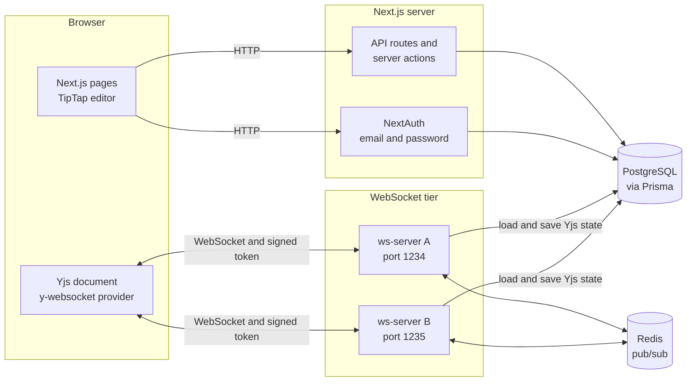
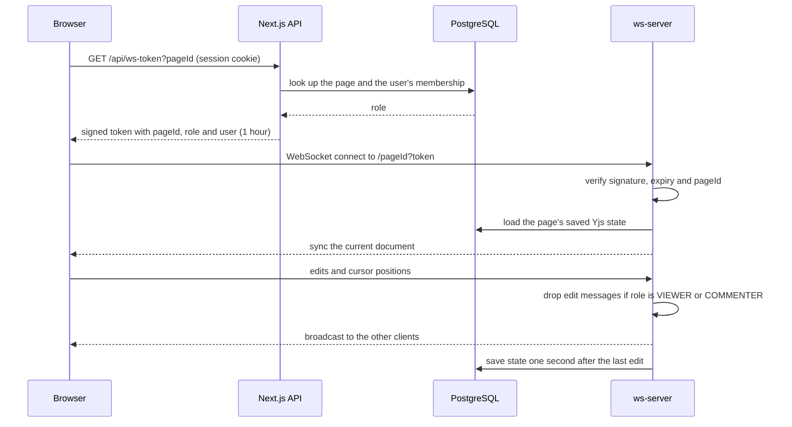
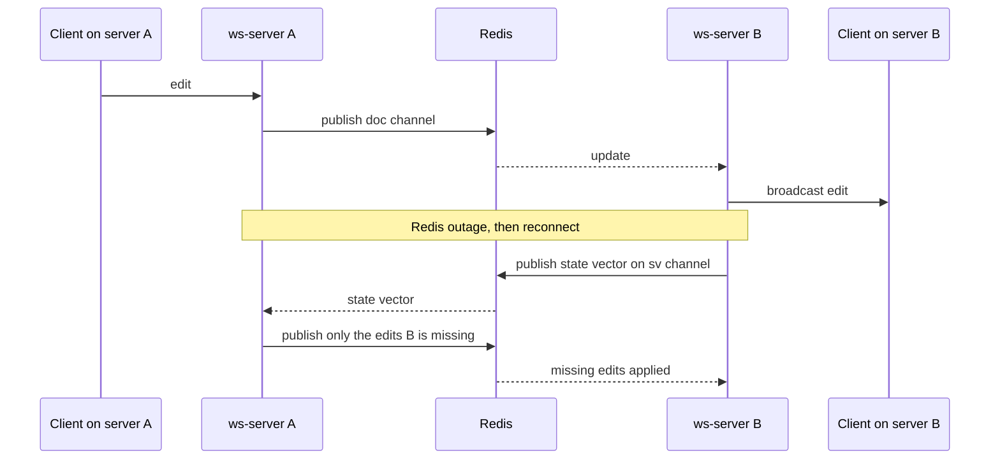
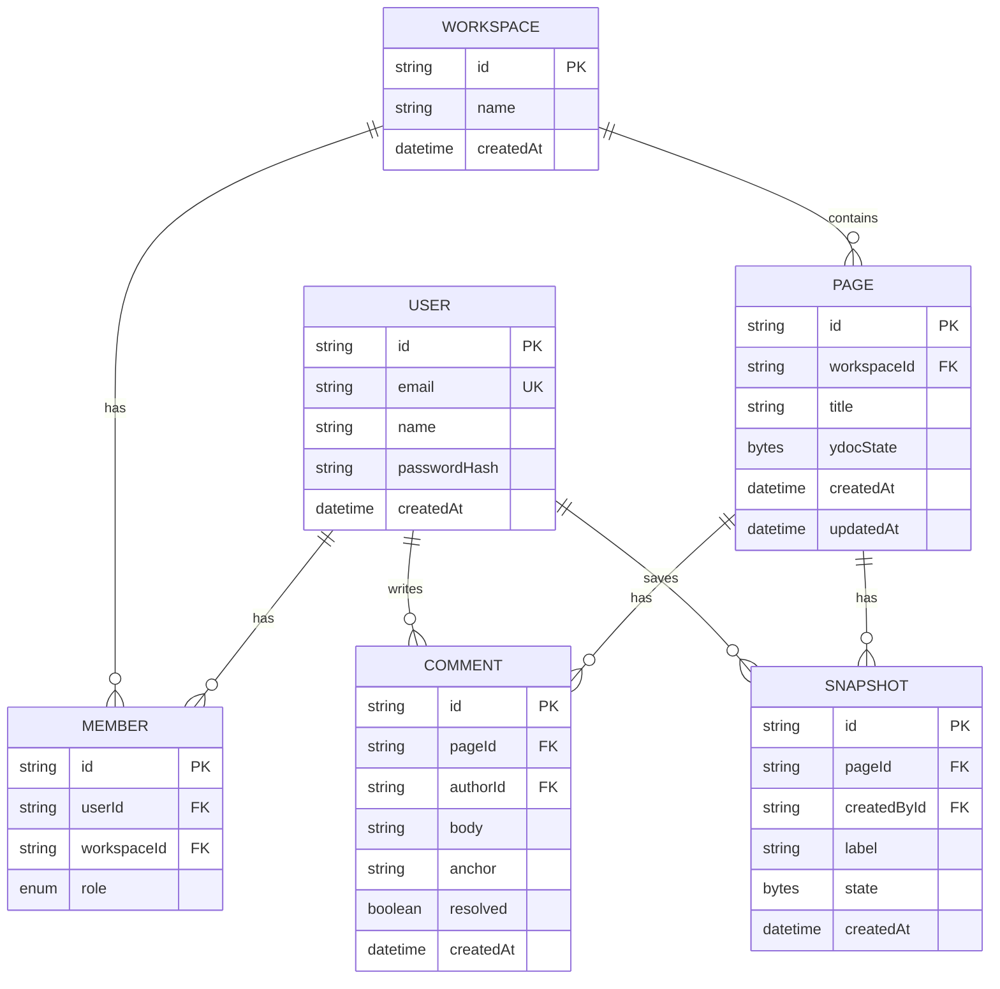

# Architecture and API Reference

This document describes how the Real-Time Collaborative Workspace is put together: the components, the data flow for the main operations, the data model, and every API the app exposes.

## 1. System overview

| Component | Responsibility |
|---|---|
| Next.js app | Pages, login, workspaces, member management, comments and snapshot APIs, issuing WebSocket tokens |
| WebSocket server (`server/ws-server.cjs`) | Live document sync and presence, token verification, read-only enforcement, saving and loading document state, Redis relay |
| PostgreSQL | Users, workspaces, memberships, comments, snapshots and each page's Yjs state |
| Redis | Relays updates and presence between WebSocket server instances |

The WebSocket server is a separate Node process because Next.js route handlers are not designed to hold long-lived socket connections.

## 2. Key flows

### 2.1 Opening a page

The browser never talks to the WebSocket server with its session cookie. It first asks the Next.js app for a short-lived token that carries the user's role for that page.

### 2.2 Scaling with Redis, and recovery

Each server publishes the updates it receives from its own clients to a Redis channel for that page, and applies updates published by the other servers. Updates that arrived from Redis are tagged so they are never published again, which prevents echo loops.

Pub/sub does not replay messages sent while Redis was down. Without the second half of this flow, server B would hold back later edits that depend on the missing ones. The state-vector exchange runs when a server opens a page and whenever its Redis subscription reconnects.

Redis channels, per page ID:

| Channel | Carries |
|---|---|
| `doc:<pageId>` | Yjs document updates |
| `aw:<pageId>` | Presence (cursor and user) updates |
| `sv:<pageId>` | A server's state vector, asking others for what it is missing |

## 3. Data model

| Table | Notes |
|---|---|
| `User` | Passwords are stored as bcrypt hashes in `passwordHash`. Email is unique and stored lowercase |
| `Member` | One row per user per workspace (unique on `userId` and `workspaceId`). `role` is `OWNER`, `EDITOR`, `COMMENTER` or `VIEWER`. Deleting a user or workspace cascades |
| `Page` | `ydocState` holds the full binary Yjs document. It is null until the first save |
| `Comment` | `anchor` is optional quoted text, not a live position |
| `Snapshot` | A full copy of a page's Yjs state at a point in time, used for version history |

## 4. Permissions

| Action | OWNER | EDITOR | COMMENTER | VIEWER |
|---|---|---|---|---|
| Read page, comments and history | Yes | Yes | Yes | Yes |
| Edit text (WebSocket writes) | Yes | Yes | No | No |
| Post a comment | Yes | Yes | Yes | No |
| Resolve a comment | Any | Any | Own only | No |
| Save a version, restore a version | Yes | Yes | No | No |
| Create a page | Yes | Yes | No | No |
| Invite, change role, remove member | Yes | No | No | No |

Enforcement points:

- **API routes and server actions** check the user's membership and role on every request
- **The WebSocket server** checks the signed token on connection and filters write messages for read-only roles
- **The editor UI** also becomes read-only and hides controls, but this is a convenience and not the security boundary

## 5. HTTP API

All routes require a signed-in session unless noted. Failures return JSON `{ "error": "..." }`.

### Authentication

| Method and path | Description |
|---|---|
| `POST /api/register` | Create an account (public). Body: `{ name, email, password }` with a password of at least 8 characters. Also creates a workspace named after the user with that user as OWNER. Returns `201 { id }`, `400` for invalid input, `409` if the email is taken |
| `/api/auth/*` | NextAuth endpoints (sign in, sign out, session). Sessions are JWT-based |

### WebSocket token

| Method and path | Description |
|---|---|
| `GET /api/ws-token?pageId=<id>` | Returns `{ token, role, user: { id, name } }`. The token is a JWT signed with `WS_SECRET`, valid for 1 hour, with claims `sub`, `name`, `pageId` and `role`. `400` if `pageId` is missing, `401` if not signed in, `403` if not a member of the page's workspace, `404` if the page does not exist |

### Comments

| Method and path | Description |
|---|---|
| `GET /api/pages/:pageId/comments` | List comments, oldest first, with author name. Any member |
| `POST /api/pages/:pageId/comments` | Body: `{ body, anchor? }` where `body` is 1 to 2000 characters and `anchor` is at most 300. Returns `201 { comment }`. VIEWER gets `403` |
| `PATCH /api/pages/:pageId/comments/:commentId` | Toggles resolved. Allowed for OWNER, EDITOR, or the comment's author. Returns `{ resolved }` |

### Version history

| Method and path | Description |
|---|---|
| `GET /api/pages/:pageId/snapshots` | List snapshots, newest first: `id`, `label`, `createdAt`, `createdBy.name`. Any member |
| `POST /api/pages/:pageId/snapshots` | Body: `{ label? }`. Saves the page's current stored state as a snapshot. OWNER or EDITOR only. `400` if the page has nothing saved yet. Returns `201 { id }` |
| `GET /api/pages/:pageId/snapshots/:snapshotId` | Returns `{ state }`, the snapshot as base64. The browser uses it to preview a version or restore it |

Restoring happens in the browser: it first saves the current content as a "Before restore" snapshot, then replaces the live document's content with the old version as a normal edit, so every connected user sees the change and history is never overwritten.

### Server actions (workspace pages)

| Action | Who | Description |
|---|---|---|
| `createPage(workspaceId)` | OWNER, EDITOR | Creates an empty page and redirects to it |
| `inviteMember(workspaceId, form)` | OWNER | Adds an existing user by email with a role of EDITOR, COMMENTER or VIEWER |
| `changeRole(workspaceId, memberId, form)` | OWNER | Changes a non-owner member's role |
| `removeMember(workspaceId, memberId)` | OWNER | Removes a non-owner member |

The owner's own membership cannot be changed or removed through these actions.

## 6. WebSocket protocol

Address: `ws://<host>:<port>/<pageId>?token=<JWT>`

| Situation | Behavior |
|---|---|
| Missing, malformed, expired or wrongly signed token | Upgrade refused with `401` |
| Token's `pageId` differs from the page in the URL | Upgrade refused with `401` |
| Role OWNER or EDITOR | Full read and write |
| Role COMMENTER or VIEWER | Receives all updates and presence. Sync messages that carry edits from this connection are dropped and never reach other clients or the database |
| Last client leaves a page | The page state is written to PostgreSQL and the Redis subscriptions for it are released |
| While clients are editing | The state is saved to `Page.ydocState` one second after the last change |

The message format on the socket is the standard y-websocket protocol (sync and awareness messages), so any Yjs client library can connect with a valid token.

## 7. Design decisions

- **CRDT (Yjs) instead of locking or last-write-wins.** Concurrent edits at different positions merge automatically and the order they arrive in does not matter, which is what makes "never lose changes" possible. The load test inserts at random positions from 30 clients and every client ends with identical text.
- **A signed token for the WebSocket, instead of reusing the session cookie.** The socket server stays independent of Next.js and can run on another host or several instances. It only needs the shared secret to verify a token that already says who the user is and what they may do on that page.
- **Role enforced on the socket, not only in the UI.** A hand-written client could send edits regardless of what the editor shows. The security test connects with VIEWER and COMMENTER tokens and confirms their edits never reach other clients or storage.
- **Redis pub/sub with a state-vector handshake.** Pub/sub is simple and fast for fan-out between servers. Its weakness, lost messages during an outage, is covered by having servers ask each other for only what they are missing.
- **Full Yjs state stored in one column.** One row read per page open and one write per save keeps the first version simple. Snapshots reuse the same format.

## 8. Known limitations

- The role in a token is fixed for the life of that connection, so a role change applies from the next connection
- The `?ws=<port>` URL parameter used for testing should be removed before a production deployment
- Whole-document saves are last-write-wins if two servers disagree at the moment of a save, until they reconcile
- Presence of a user on another server can take a moment to appear, because presence is only relayed when it changes
- Comments are polled every 3 seconds and are not tied to a position in the text
- No email verification or rate limiting on sign-up and login
